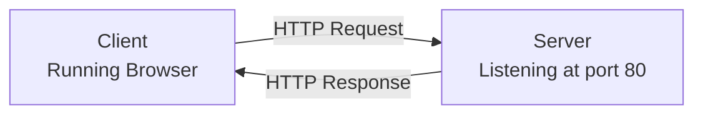

# SETTING UP A SERVER WITH HTTP

## Introduction to HTTP
HTTP, short for Hypertext Transfer Protocol, is a request-response protocol that serves as the foundation of data exchange and computing within the client-server computing model.

Simpler terms is that HTTP helps facilitate the exchange of information between a client (i.e. website, mobile app) and a server.

 1. The client submits an HTTP request message to the server.
 2. The sever receives the HTTP request, performs some function on behalf of the client according to the request.
 3. The server returns a response message to the client containing important information about the processing of the request.

```text
        Client                              Server
   (Running Browser)                 (Listening at port 80)
            |                                   |
            |---------- HTTP Request ---------->|
            |                                   |
            |<--------- HTTP Response ----------|
```


## The Structure of HTTP
HTTP requests and responses have specific structures to help facilitate the exchange of information between a client and a server.

### Requests
1. HTTP Method: The Http method is usually a verb, such as GET or POST, or a noun such as OPTIONS or HEAD
2. Path: The path denotes the path of the resource relative to the root URL. for example, making a GET request to **https://codeacademy.com/api/lessons** would strip common elements such as the protocol (**https://) and domain (codeacademy.com,) leaving the path of /api/lessons**
3. HTTP Protocol Version: The version of the HTTP protocol (I.e. HTTP/1.1, HTTP/2, and HTTP/3)
4. Headers: Headers are optional information that may be important in processing a request by a server.
5. Body: The body contains data required to be sent to the server to process a request, most common to see a body attached to requests with verbs such as POST, PUT, and PATCH.

### Responses
Responses are comprised of elements similar to those in requests, with a few differences.
1. HTTP Protocol Version: The version of the HTTP protocol
2. Status Code: The status code indicates whether or not the request was successful and why.
3. Status Message: The status message provides a short description of the corresponding status code.
4. Header: These response header are similar to those provided in a request
5. Body: The body of a response contains data corresponding to the fetched resource.


## The movement of HTTP
The requests/responses contain all of the information needed to communicate with other entities on the web efficiently, but how do these messages actually make it to their destinations? Just as a letter requires a carrier to arrive at its destination, so too does an HTTP requesr.

#### TCP
The most common transport protocol used in conjunction with HTTP is **TCP**
stands for Transmission Control Protocol and allows two hosts to connect and exchange data streams, guaranteeing the delivery of data packets in the order as they were sent.

Before any other data is sent, the client and server establish a connection via a method called **handshaking**. This connection means that TCP ensures that packets are delivered reliably and free from errors

#### UDP
UDP, or User Datagram Protocol, is a less commonly used transport protocol. It operates using a connectionless communication model, requiring no handshaking

#### TLS 
TLS, also known as Transport Layer Security, is a widely adopted security protocol designed to facilitate secure data transmission via encryption.
TLS evolved out of the encryption protocol known as SSL (Secure Sockets Layer)

#### HTTP/1.1 
Was one of the first versions of the HTTP protocol to be designed and implemented. It operates by sending messages in the form of text
HTTP/1.1 is commonly used over TCP and is the slowest of the HTTP versions regarding data transmission.

#### HTTP/2
is a major version of HTTP/1.1, developed with the intent to try and reduce web page load latency. However, the most significant departure from HTTP/1.1 is the encapsulation of all messages in binary format rather than plain text.

#### HTTP/3
is the third major version of HTTP while there are quite a few complex technological differences between HTTP/3 and the previous versions
One of the most important is how the protocol deals with lost packets

## The HTTP Module
The process HTTP requests in JavaScript and Node.js, we can use the built-in **http module**.
http is not a global module, so it must be imported before use.

The http module includes various methods that are useful for engaging with HTTP network requests and responses.
**.createServer()** method. This methods it creates an HTTP server.
 - The .createServer() method takes a single argument in the form of a callback function. This callback function has two primary arguments: the request (commonly written as req) and the response (commonlu written as res).
 - The req object contains all of the information about an HTTP request ingested by the server
   - It exposes information such as the HTTP method (GET, POST, etc.), the pathname, headers, body and so on
   - The res object contains methods and properties pertaining to the generation of a response by the HTTP server. This object contains methods such as **.setHeader()** (sets HTTP headers on the response),
    **.statusCode** (set the status code of the response), and .**end()** (dispatches the response to the client who made the request). In the preceding code, we use the .end() method to send the string 'Server is Running!' to the client


## The Anatomy of the URL
A URL can provide a great deal of information about a request and how it is expected to behave.
(**https://codeacademy.com/articles?search=node**)

1. Protocol: The protocol of the url denotes which protocol is being used for this particular resource. For instance a URL could have a protocol of HTTP (http://) or HTTPS (https://)
2. Domain: The domain of the URL is a unique reference that identifies a website on the Interent
3. Path: The path refers to a file or directory on the web server
4. Query: The query is commonly found on pages that contain dynamic content. Queries are prefixed by a question mark (?) and appear at the end of a URL
  - Queries can be comprised of multiple key=value pairs, separated by an ampersand (&) with each key being assigned it corresponding value using an equals sign (=)